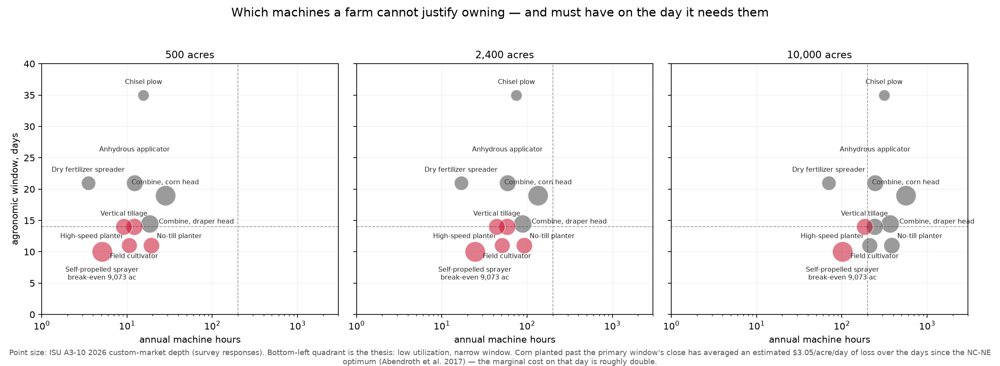
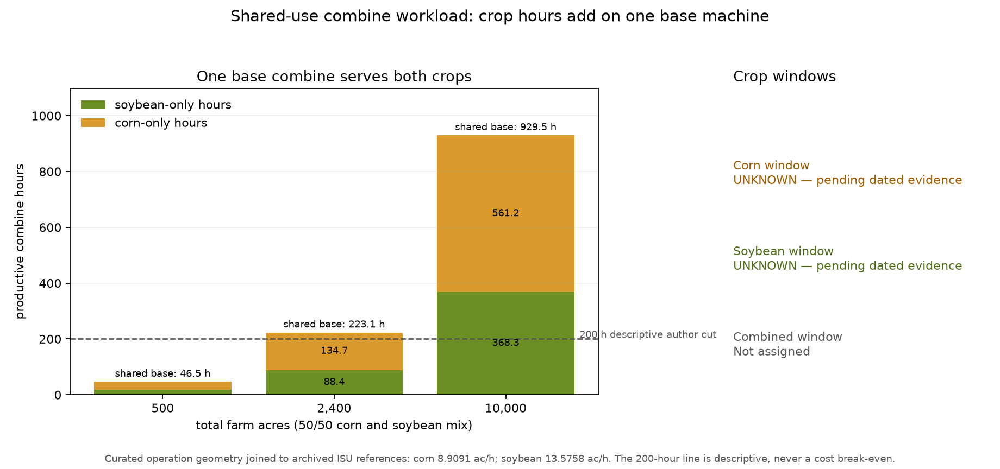

# Deere Farm ROI Copilot: who should own the machine?

I set out to build a tool that tells an Iowa farmer whether a John Deere
See & Spray sprayer pays for itself. For a typical 2,400-acre farm the tool's
answer was blunter than the question: the farm should not own the sprayer at
all. I rebuilt the case study around that answer. For each machine, which
customer should own it: the farm, or a custom operator serving many farms?
Then I tested the idea against how Iowa's custom-hire market actually behaves,
and this page reports where it held and where it did not.

*Independent work. Not affiliated with or endorsed by Deere & Company. Every
published number comes from public data. Scope is Iowa corn and soybeans.*

## Results at a glance

| Question | Result | How solid |
|---|---|---|
| Should a 2,400-acre farm own a $650,000 sprayer? | No. It would run 24 hours a year. Owning beats hiring at 9,073 acres sprayed a year; this farm sprays 4,800. | Sourced prices, one author-estimated input |
| Does the See & Spray upgrade pay back? | Depends on the herbicide cost source: 10-year NPV is +$70,877 on one, −$7,731 on the other. | Sign is not robust |
| Do "rarely used, must be on time" machines match Iowa's deep custom markets? | 5 of 8 at 500 and 2,400 acres. 3 of 8 under wider window definitions. 2 of 8 at 10,000 acres. | Thesis not confirmed |
| What does a day of late corn planting cost? | About $3.05 per acre per day. | The only operation of ten with a usable published curve |
| Does a machine-learning yield model beat a plain historical baseline? | No. It won 4 of 10 held-out years for each crop, so the baseline ships. | Tested on 2016–2025; see the [model card](deliverables/appendix/model-card.md) |
| Should that farm own a combine? | Unknown. Counted as one machine it runs 223 hours a year, but no defensible ownership price exists. | Indeterminate, by design |
| Can this plug into Deere's own data? | Yes. 10 of 13 Operations Center endpoints authorize against the live sandbox. | Real client, empty account |

## 1. The customer trade-off

The same acres can reach Deere through three different customers:

| Customer | What they get | What they give up |
|---|---|---|
| Farm that owns | The machine on the day it is needed | Pays for iron that sits idle most of the year |
| Farm that hires | No capital tied up | Depends on the operator arriving on time |
| Custom operator | Spreads one machine over many farms | Must serve every client inside the same short window |

Eight 2,400-acre farms and one custom operator can cover the same 19,200
acres. The difference is who can justify the machine, and so who would also
pay a per-acre software fee on it.

Two forces decide which customer wins:

- **Utilization.** The fewer hours a machine runs, the worse ownership looks.
- **Timeliness.** The shorter the window to do the job, the riskier hiring is.

The exhibit plots ten field operations on those two axes at three farm sizes.
Bubble size is the number of Iowa providers reporting a custom rate.



**The test.** If the idea is right, machines in the bottom-left corner should
be the ones Iowa already hires out most. I set the quadrant cuts and the
window definition before running the check, so I could not pick the flattering
version afterward.

**What happened.**

- The sprayer and vertical tillage matched at every farm size.
- Overall agreement was 5 of 8 at 500 and 2,400 acres, and 2 of 8 at 10,000.
- Under two wider, equally defensible window definitions it fell to 3 of 8.
- The two combine rows disagreed at every size and under every definition.

So the sprayer case is strong and the general rule is not proven. The window
axis is the weak point: the same USDA data, read two defensible ways, points
in opposite directions.

## 2. Getting into the Deere API

The claim "this could sit on top of Operations Center" is only true if the
credentials work, so I built the client first and wrote the decision down in
[ADR 0001](docs/decisions/0001-deere-provider.md).

- OAuth, organization discovery and link traversal run against the live sandbox.
- 10 of 13 endpoints return data-shaped responses; 3 stay forbidden.
- The connected account holds no farm records, so the demo runs on a stand-in
  provider with the same interface. Swapping in real data is a config change.

Three traps were invisible in the documentation and only showed up on live calls:

| Trap | Why it matters |
|---|---|
| An unconnected account returns `200` with an empty list | Reads as "this farm has no fields" when it means "not connected yet" |
| The docs say `manage_connections`; the API sends `manage_connection` | A working connection was classified as unknown |
| Sandbox responses link to production URLs | Following them as designed walks a test client into production |

Each is pinned by a test in [tests/test_deere_spike.py](tests/test_deere_spike.py).
I chose not to fill the sandbox with invented field records: that would
manufacture the evidence this project promises not to fake.

## 3. The combine: catching a flaw in my own model

The combines kept breaking the pattern, so I looked at why. The data had one
row for the corn head and one for the soybean head, and the plot treated them
as two separate, lightly used machines. A farm owns one combine and swaps the
head.



- Counted once, the combine runs 134.7 + 88.4 = **223 hours a year** at 2,400 acres.
- That is above the 200-hour line that either crop alone falls under.
- It corrects the picture. It does not make a purchase case.

I then set a rule for the follow-up: no number gets published without a
source, and both cost and timing must pass before any option is called a
winner. Under that rule the answer is **indeterminate**:

- The only supported figure is hiring both harvests at survey rates: $106,920 a year.
- No dated, itemized price exists for a combine plus both heads, new or used.
- No evidence shows either owning or hiring finishes both crops when harvests overlap.

The output is a checklist of what to ask the customer for: itemized quotes,
harvest dates, crew hours, and a written hire commitment. Detail is in
[combine-analysis.md](deliverables/appendix/combine-analysis.md).

## What comes next: sizing the opportunity

This is the unbuilt part, and how I would approach it.

- **Question.** How many acres sit with customers who can justify each machine,
  and what is that worth at a per-acre fee?
- **Data.** USDA Census of Agriculture farm counts by size, plus custom-work
  expense as a way to back into the custom-operator share.
- **Method.** Segment acres by customer type, apply each segment's return from
  the existing engine, and convert to engaged acres.
- **First gate.** Can the custom-operator segment be sized from public data at
  all? If not, it ships as a labelled range.
- **Known weak point.** No public adoption curve exists. The fallback is a
  plain cut: positive return means addressable.
- **Carried forward.** Count the machine a farm actually buys, not the
  operation. Report the 3-of-8 result next to the 5-of-8 one.
- **What Deere's data would replace.** Machine hours from telematics would
  replace my utilization estimates, which is the seam the API client proves.

## How I worked

<!-- TODO(Tanner): confirm and rewrite this section in your own words. -->

I built this with AI coding agents (Claude Code and Codex) doing most of the
typing. The calls below were mine:

- Reframing the case when the first answer was "don't buy".
- Dropping a dealer rental-fleet model once its premise turned out wrong.
- Fixing the test definitions before running them.
- Requiring a model to win most held-out years, not just the average, before it ships.
- Building a real API client and refusing to fabricate sandbox data.
- Questioning why combines broke the pattern, then blocking any unsourced price.

## Reproduce

Run from the repository root.

```bash
uv sync --all-packages --all-extras --all-groups
```

```bash
uv run pytest
```

```bash
uv run python case-studies/john-deere-roi-copilot/scripts/figures.py
```

```bash
uv run python case-studies/john-deere-roi-copilot/scripts/harvest_analysis.py
```

- The test run covers 398 tests and needs no network or API keys.
- `figures.py` rebuilds the landscape figure and prints the agreement table.
- `harvest_analysis.py` rebuilds the combine exhibits and the options table.
- Two small USDA extracts under `data/raw/` are tracked so a fresh clone
  reproduces the published numbers.
- Retraining the yield model or refitting the priors needs the full USDA and
  weather pulls, which are not tracked. See `.env.example` for the free API key.

## What is in here

| Path | Contents |
|---|---|
| `engine/` | Machinery cost, finance, landscape, timeliness and harvest math |
| `etl/` | USDA ERS, USDA NASS, Open-Meteo and Iowa State reference loaders |
| `ml/` | County yield model bake-off and fitted yield and price priors |
| `scripts/` | Figure builders and the Deere API discovery spike |
| `tests/` | Unit tests for every module above |
| `deliverables/appendix/` | [Sources](deliverables/appendix/sources.md), [assumptions](deliverables/appendix/assumptions.md), [model card](deliverables/appendix/model-card.md) |

## Limits

- Iowa corn and soybeans only. The method generalizes; the numbers do not.
- Six of ten agronomic windows are still my estimates, including the sprayer's.
- Nothing here is new to Deere, which has telematics I do not. The claim is
  method and speed: a defensible model of the customer's decision, built from
  public data, that is free to recommend not buying.
